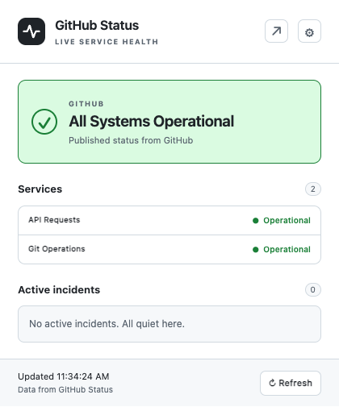

# GitHub Status Indicator

A small, local-first Chrome / Chromium extension for GitHub's published service health. Manifest V3, no account, no backend, no telemetry. This is an independent project, not affiliated with or endorsed by GitHub.

The extension displays overall status, affected-first services, incidents and maintenance, with a colored pulse icon, automatic checks, immediate manual refresh, and light/dark themes. Only `storage`, `alarms`, and access to `https://www.githubstatus.com/*` are requested. The pulse mark is original artwork; the GitHub name identifies the monitored platform.



Example popup rendered in Chromium with test data; this is not a live status report.

## Install a signed release

The installer supports **macOS and Linux**. It installs a ready-to-use release; Node.js, Go, and the source repository are not needed. Install GitHub CLI (`gh`), **cosign 3.1.4 or newer**, `jq`, `unzip`, and either `shasum` or `sha256sum` first. The repository is currently private, so authenticate with `gh auth login` using an account that has access. The extension itself never receives your GitHub credentials.

**The installer requires a new signed release.** The existing `v0.1.0` and earlier RCs have no cosign bundle and remain immutable. The installer rejects those releases instead of bypassing signature verification. Version `0.1.1` is prepared for the first signed release; the commands below work after that release is published.

### Verify the installer before running it

Download the release assets into a new directory, verify the signed checksum list against the exact release workflow identity, then verify every checksum. This authenticates `install.sh` as well as the ZIP before executing downloaded code. Do not pipe an unverified download into a shell.

macOS example (on Linux, replace `shasum -a 256 -c` with `sha256sum -c`):

```bash
release_tag=v0.1.1 # Use a published signed tag; an RC tag is also accepted.
release_dir="$HOME/Downloads/github-status-extension-$release_tag"
mkdir -p "$release_dir"
gh release download "$release_tag" --repo cpanato/github-status-extension --dir "$release_dir"
cosign verify-blob \
  --certificate-identity "https://github.com/cpanato/github-status-extension/.github/workflows/release.yml@refs/tags/$release_tag" \
  --certificate-oidc-issuer https://token.actions.githubusercontent.com \
  --bundle "$release_dir/SHA256SUMS.sigstore.json" "$release_dir/SHA256SUMS"
(cd "$release_dir" && shasum -a 256 -c SHA256SUMS)
```

Continue only if both verification commands succeed. Save the verified helper and install from the downloaded assets:

```bash
mkdir -p "$HOME/.local/bin"
cp "$release_dir/install.sh" "$HOME/.local/bin/github-status-extension-install"
bash "$HOME/.local/bin/github-status-extension-install" --version "$release_tag" --from "$release_dir"
```

The helper independently verifies the signature and ZIP checksum again before changing installed files. It prints the permanent folder to select in Chrome. Defaults are:

| System | Default installation folder                                                                    |
| ------ | ---------------------------------------------------------------------------------------------- |
| macOS  | `~/Applications/github-status-extension`                                                       |
| Linux  | `$XDG_DATA_HOME/github-status-extension`, or `~/.local/share/github-status-extension` if unset |

For another location, add `--dir "/your/permanent/folder"` to the installer command. Use that same `--dir` on future updates. Installer data and extension files stay out of Chrome's profile directories.

### Load the extension in Chrome once

1. Open `chrome://extensions` and enable **Developer mode**.
2. Click **Load unpacked** and select the permanent folder printed by the installer. Its root must contain `manifest.json`.
3. Pin **GitHub Status Indicator** from Chrome's puzzle-piece extensions menu. Click the pulse icon to view status; use the gear for preferences.

In the macOS folder picker, **Command–Shift–G** lets you paste the folder path. Keep this folder in place while the extension is installed. Downloaded ZIPs can be deleted after installation.

### Update

```bash
bash "$HOME/.local/bin/github-status-extension-install" --update
```

This selects the latest stable release, verifies its signature and checksum, stages its files, and replaces the existing installation at the **same path**. A previous copy is kept beside it as `<installation-folder>.previous`; a failed file swap restores the old folder. The installer refuses unrelated directories and concurrent updates.

For a specific version or a custom installation folder:

```bash
bash "$HOME/.local/bin/github-status-extension-install" \
  --update --version v0.1.1 --dir "$HOME/Applications/github-status-extension"
```

After the command succeeds, click **Reload** (the circular arrow) on the extension's card in `chrome://extensions`. Use Reload instead of Remove so you update the existing installation. Check **Details** for the version. Updates do not run on a timer, and the helper does not silently upgrade itself; repeat the verified bootstrap to replace the helper when needed.

To return to an older **signed** version, pass its tag through `--version` and then reload. There is no unsigned fallback or `--skip-verify` mode.

## Manual installation without the helper

Windows users and users who prefer manual file handling can still download a runtime ZIP. For signed releases, verify `SHA256SUMS` with cosign and the ZIP's SHA-256 digest before extracting, using the identity shown above. `SHA256SUMS` covers the ZIP, its compatibility `.zip.sha256` file, and `install.sh`; `SHA256SUMS.sigstore.json` authenticates that list. GitHub's automatically generated **Source code** archives are not the installable extension.

Extract the ZIP into a permanent folder (for example `%LOCALAPPDATA%\GitHubStatusExtension` on Windows), select the folder containing `manifest.json` using **Load unpacked**, and pin the extension. For updates, replace the files in that same folder and click **Reload**. Do not move the installation into a version-specific subfolder. Chrome loads these files from the selected folder, so deleting or moving it breaks that installation.

The earlier unsigned `v0.1.0` can still be handled using its original manual instructions and ZIP checksum, but it cannot be authenticated with cosign. The new installer intentionally does not accept it.

See Chrome's [Load unpacked and Reload instructions](https://developer.chrome.com/docs/extensions/get-started/tutorial/hello-world#load-unpacked).

## Release verification and trust

The installer pins both the certificate identity `https://github.com/cpanato/github-status-extension/.github/workflows/release.yml@refs/tags/<tag>` and OIDC issuer `https://token.actions.githubusercontent.com`. A signature from another repository, workflow, tag, issuer, or an arbitrary local key is not accepted. Checksums alone do not authenticate a publisher.

The tag-triggered Release workflow is independent of CI and has no manual trigger. Its build job is read-only. A separate signing job has only read access and `id-token: write` for keyless cosign signing; only the publishing job has `contents: write`. Publication creates a draft, uploads **all** assets, downloads and verifies signatures/checksums, then publishes the immutable release. Published tags and assets are not replaced.

Keyless signing uses the public Sigstore transparency infrastructure. Certificate identity, commit metadata, and artifact digests become public even while the GitHub repository is private; artifact bytes and GitHub credentials are not published to the log. No signing key is stored in the repository.

## Build from source

Requires Node.js 26 LTS or newer and npm. Run `nvm install && nvm use` if using nvm. Bash, jq, zip, and shasum are used for packaging.

```bash
npm ci --ignore-scripts
npm run build
```

For development, load this checkout/worktree's generated `dist` directory in Chrome. Rebuild and click Reload after code changes. This is a source build, not a signed release; the installer does not accept it.

```bash
npm run package
```

Packaging writes `artifacts/github-status-extension-0.1.1.zip`, its `.zip.sha256` checksum, `install.sh`, and `SHA256SUMS`. Signing occurs only in the release workflow after verification; the unsigned local build has no Sigstore bundle.

Push a tag matching the version in `package.json` and `public/manifest.json`, such as `v0.1.1` or `v0.1.1-rc.1`, after merging the changes and passing checks. RCs are prereleases and do not become the latest stable release. Chrome keeps a numeric version, while `version_name` carries the tag's RC suffix.

To prepare an unsigned RC package locally:

```bash
npm run build
bash scripts/prepare-release.sh v0.1.1-rc.1
bash scripts/package.sh
```

## Validation

```bash
npm run typecheck
npm run lint
npm test
npm run test:release
npm run test:installer
npm run test:installer:crypto # Requires real cosign 3.1.4+.
npm run build
npm exec --no -- playwright install chromium
npm run test:e2e
npm audit --audit-level=moderate
```

Installer flow tests use isolated gh/cosign shims to exercise downloads, exact identity/issuer checks, failed verification, ZIP safety, custom folders, backups, and failed-update recovery. The separate cryptographic test uses real cosign and an ephemeral local key to prove that a valid signature without the trusted workflow certificate is rejected, and tampered signed bytes fail verification. Its test-only key verification does not relax production verification. Live GitHub OIDC signing is exercised by the tag release workflow.

Playwright loads the built extension in real Chromium. External status requests use deterministic fixtures; messaging, storage, alarms, icons, and pages remain real. Screenshots are saved in `test-results`. The README preview is a cropped popup screenshot copied from that output. Run `npm run format` to format files; regenerate original icons using `go run scripts/icons.go`.

## Behavior and limitations

- Automatic checks default to one minute, with 1/2/5/10-minute presets. Chrome can delay alarms during sleep.
- Failed checks retain cached details and mark them stale. Expired data never produces a fresh healthy toolbar icon.
- The original pulse icon is green for operational, yellow for degraded/maintenance, red for partial/major outage, and gray for unknown/stale/error. Badges and tooltip text supplement color. See [icon sources](assets/README.md).
- Manual Refresh fetches immediately regardless of the automatic interval or automatic retry backoff. It confirms progress/success/failure, and timestamps include seconds. An explicit provider Retry-After produces a visible countdown. Requests have a ten-second timeout, a 1 MiB response cap, no credentials, and no redirects.
- The summary feed provides current incidents and maintenance, not complete history or uptime metrics. GitHub is the only configured provider.
- Updates require a user-run installer command and Chrome reload. This project is distributed manually, outside the Chrome Web Store.

Architecture: providers normalize data, the domain defines severity and models, the service worker owns polling/cache/toolbar, and UI pages render local content. Native TypeScript modules keep runtime dependencies minimal. Bash handles installation and packaging; Go generates the original PNG assets.

See the [technical design](docs/design/github-status-extension-design.md), [GitHub Status API](https://www.githubstatus.com/api), and [Chrome alarms](https://developer.chrome.com/docs/extensions/reference/api/alarms).
